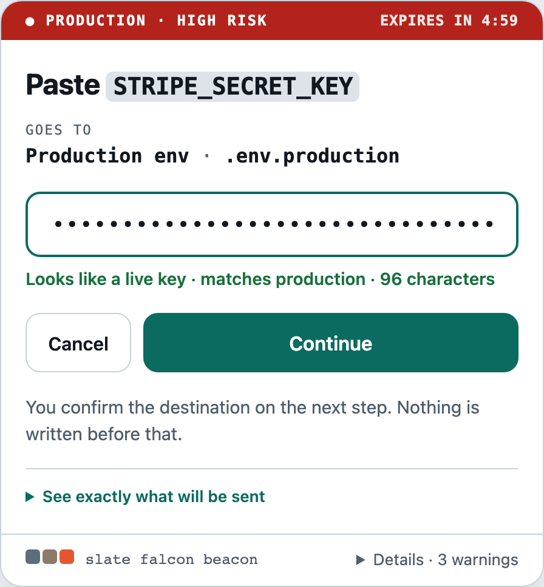
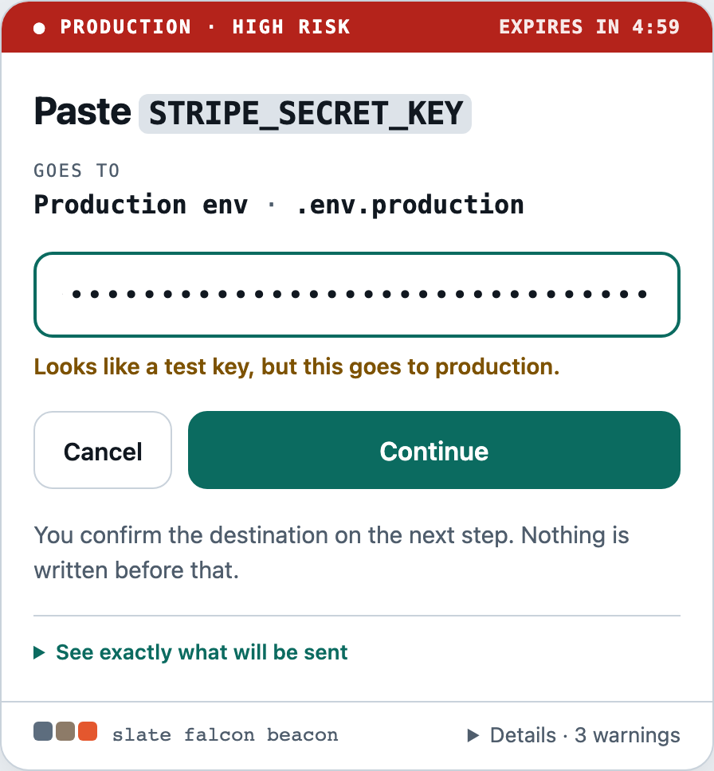
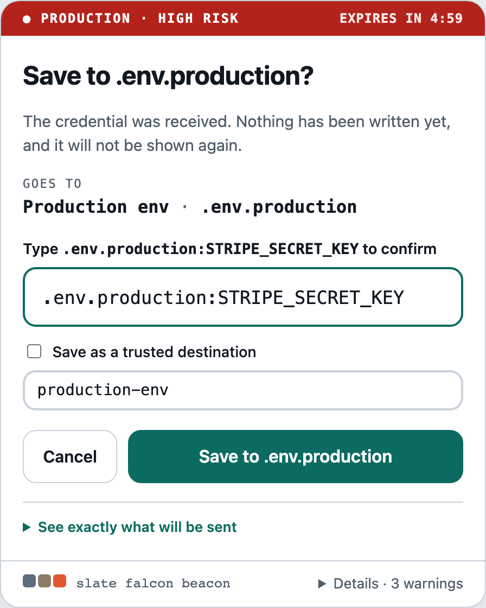
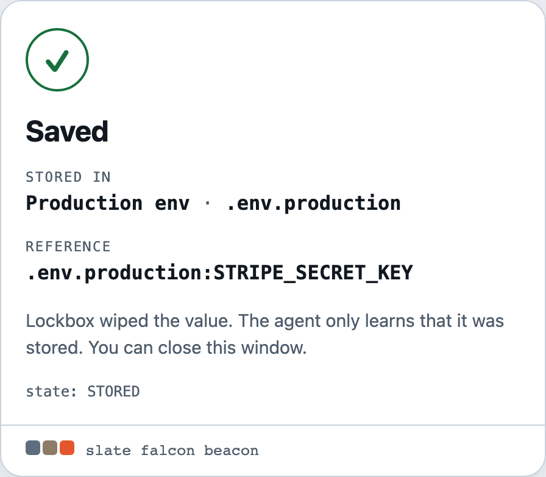

# Lockbox

**Let your AI agent set up API keys without ever seeing them.**

[](https://github.com/rosostolato/lockbox-mcp/actions/workflows/ci.yml)
[](LICENSE)
[](https://nodejs.org/)

You ask Claude, Cursor or any MCP client to *"put the Stripe key in our .env"* — or in Secret
Manager, Vercel, your own API. The agent describes **where** it goes. You read that in Lockbox's
own window and paste the value there. The key goes straight to the destination and never
enters the chat, the prompt or the logs.

<p align="center">
  <picture>
    <source media="(prefers-color-scheme: dark)" srcset="docs/images/paste-dark.png">
    
  </picture>
</p>

1. **The agent describes the destination.** A file, a program such as `gcloud`, or an HTTPS
   request, with `{{secret}}` where the value goes. The tool has no field that could carry a
   value.
2. **You check and paste.** Lockbox's local window shows where the key goes in one line, warns
   about anything new or odd, and checks the key's format. The exact request is one click
   away.
3. **Lockbox sends it.** The agent only learns `STORED` and a reference. It never sees the key.

```bash
claude mcp add lockbox -e LOCKBOX_ENV_ALLOWED_ROOTS="$PWD" -- npx -y lockbox-mcp serve
```

Then ask your agent: *"store my Stripe test key in .env"*.

---

## Install

Lockbox is a stdio MCP server, so you do not run it yourself — your MCP client starts it, the
same way it starts any other npm-published server. Requires Node 20+.

### Claude Code

```bash
cd ~/some/project
claude mcp add lockbox -e LOCKBOX_ENV_ALLOWED_ROOTS="$PWD" -- npx -y lockbox-mcp serve
```

Add `-s project` to record it in the repository's `.mcp.json` instead of your own config.

### Any other client (Claude Desktop, Cursor, Windsurf, VS Code, Zed…)

Drop this into the client's MCP configuration — the `mcpServers` block is the same shape
everywhere:

```json
{
  "mcpServers": {
    "lockbox": {
      "command": "npx",
      "args": ["-y", "lockbox-mcp", "serve"],
      "env": {
        "LOCKBOX_ENV_ALLOWED_ROOTS": "/absolute/path/to/your/project"
      }
    }
  }
}
```

Prefer a pinned install to an ephemeral one:

```bash
npm install -g lockbox-mcp
# then use `lockbox-mcp serve` as the command, with no npx
```

The package is published to npm, unscoped, as `lockbox-mcp`.

**Set `LOCKBOX_ENV_ALLOWED_ROOTS`.** File destinations refuse to write outside those
directories, and they default only to the server's working directory. Everything else is
optional — see [Configuration](#configuration).

Destinations behind a login (Google Secret Manager, Vercel, GitHub) are reached through their
own CLI, which uses the login you already have — `gcloud`, `vercel`, `gh`. See
[Destinations](#destinations).

### First run

Ask your agent for something like *"store my Stripe test key in .env"*. Lockbox opens its
window on your machine; the agent does not receive that link. The band at the top tells you
the environment at a glance, and the field tells you whether the key looks right before you
send it.

<table>
  <tr>
    <td width="33%" valign="top">
      <picture>
        <source media="(prefers-color-scheme: dark)" srcset="docs/images/warning-dark.png">
        
      </picture>
      <p><strong>Catches the wrong key.</strong> A <code>test</code> key headed for
      production gets flagged in the window. The check runs locally and never shows the
      value.</p>
    </td>
    <td width="33%" valign="top">
      <picture>
        <source media="(prefers-color-scheme: dark)" srcset="docs/images/confirm-dark.png">
        
      </picture>
      <p><strong>Confirms before sending.</strong> Nothing is sent until you type where it
      goes: the host, the program or the file.</p>
    </td>
    <td width="33%" valign="top">
      <picture>
        <source media="(prefers-color-scheme: dark)" srcset="docs/images/saved-dark.png">
        
      </picture>
      <p><strong>Tells the agent only "stored".</strong> Lockbox wipes the value and hands back
      a reference such as the file and variable.</p>
    </td>
  </tr>
</table>

<kbd>Enter</kbd> continues and <kbd>Esc</kbd> cancels. The link works once: if anything
opened it before your browser did, Lockbox shows an alarm and a Cancel button instead of the
request. Lockbox's stderr carries structured audit JSON; nothing else is expected of you in the
terminal.

---

## What Lockbox solves

It removes an entire class of failures caused by the agent **knowing** the secret.
With Lockbox in the loop, a credential does not pass through:

- LLM prompts or conversation history
- MCP tool arguments or tool results
- agent memory or generated code
- shell command arguments or process argv
- logs, debug traces or telemetry
- URLs
- model-visible command output

## What Lockbox does **not** solve

Lockbox does not make an AI agent trustworthy, and it is not "safe AI". It does not
guarantee that the agent picked the right destination, that it understood you, that it
is free of prompt injection, that the destination is itself secure, that your machine is
uncompromised, or that a credential cannot be misused later by software that legitimately
receives it.

There are two separate problems here:

| Question | Lockbox's answer |
| --- | --- |
| Should the agent know the secret? | No. |
| Should the agent decide alone where the secret goes? | Not without human authorization. |

Lockbox answers those two. It does not claim to answer the rest.

---

## Trust model

```text
Trusted with the credential value:

  The human at the keyboard
  Lockbox's secure input UI       (loopback only, in your control)
  Lockbox's secure input broker   (this process)
  The destination you approved    (a file, a program, an HTTPS endpoint)

NOT trusted with the credential value:

  The LLM
  The agent / MCP client
  The conversation
  The prompt and any repository content it read
  Generated code
  Logs, telemetry, crash reports
```

Lockbox's runtime dependency list is one package (`zod`, for input validation). The MCP
protocol is implemented in-tree rather than through the official SDK, which would add ~90
packages — including HTTP servers and an OAuth stack — to a process that holds plaintext
credentials.

This diagram does not claim the trusted components are invulnerable. It says where the
credential is *allowed* to exist. Lockbox is security-sensitive software: if Lockbox itself is
malicious or compromised, the boundary is gone. Its source, dependencies and releases
deserve the scrutiny you would give any credential-handling tool.

---

## The two flows

**The secret flow** — the human's path, which the model cannot observe:

```text
Human ─▶ Lockbox secure UI (127.0.0.1) ─▶ Broker ─▶ approved definition ─▶ Destination
```

**The agent flow** — everything the model sees:

```text
LLM ─▶ MCP client ─▶ Lockbox MCP server ─▶ non-sensitive result metadata
```

The MCP tool schema has no property capable of carrying a credential. That is structural,
not a prompt instruction: there is no `value`, `secret_value`, `password`, `token`,
`content` or `raw_secret` field to abuse, closed schemas reject unknown properties, and
arguments are screened for credential-shaped values before they are parsed.

### What the agent calls

```json
{
  "destination": "custom",
  "name": "STRIPE_SECRET_KEY",
  "target": {
    "definition": {
      "kind": "command",
      "label": "Google Secret Manager",
      "executable": "/opt/homebrew/bin/gcloud",
      "args": ["secrets", "versions", "add", "stripe-secret-key",
               "--project", "acme-prod", "--data-file=-"],
      "stdin": "{{secret}}"
    }
  },
  "environment": "production",
  "description": "Stripe production API key"
}
```

Lockbox replies with a `request_id`, a risk classification and the normalized destination —
and opens its own authorization window on your machine. The agent polls `secret_status`.
`destination: "saved:<name>"` reuses a destination the human saved earlier.

**The agent does not get the authorization link.** That link is a capability: anything
holding it can complete the human's half of the flow, and an agent with a shell or an HTTP
tool is precisely the threat model. Lockbox hands it straight to your browser. Set
`LOCKBOX_DISCLOSE_AUTHORIZATION_URL=true` if your setup needs the agent to relay the link (for
example, a remote or headless session) — and understand that this lets a compromised agent
authorize its own request.

**The link works once.** Opening it trades it for an `HttpOnly; SameSite=Lax` session cookie
scoped to that request and redirects to an address with no token in it; every later page and
form needs the cookie. A second opening of the same link gets an alarm page ("This link was
already opened") with a Cancel button, never the request. So a copy left in browser history,
a process list or a log is dead once you open it, and one used by someone else first is
visible to you.

**Logs never hold the identity phrase, and hold the link only as a last resort.** MCP hosts
save server stderr to files any process running as you can read (Claude Desktop under
`~/Library/Logs/Claude/`, Claude Code under its cache directory), so the audit record carries
a short fingerprint of the link instead. The full link is logged only when no browser could
be opened (`LOCKBOX_OPEN_BROWSER=false`, too many windows, or the opener failed), because the
operator then has no other way in.

| Tool | Purpose |
| --- | --- |
| `secret_store` | Create a credential request. Returns non-sensitive metadata and a request id. |
| `secret_status` | Poll a request. Never returns credential material. |
| `secret_cancel` | Cancel a pending request; any entered value is destroyed. |
| `secret_revise` | Invalidate an authorization and start a new one. Nothing is edited in place. |
| `secret_destinations` | The definition contract, worked examples, and the user's saved destinations. |

### What the human sees

Stage A shows the credential name and **one destination line** — the definition's label and
its host, program or file — plus a line for anything worth a second look: a host never
used before, a host spelled with non-ASCII characters, an IP address instead of a name, a
program outside the system folders, a saved destination that changed. The full request (the
URL, every header and the body; or the program, each argument and stdin; or the file and
its content) sits behind **"See exactly what will be sent"**, closed by default, with the
canonical JSON and its hash. Every custom destination needs a second confirmation in Stage
B, after entry and before anything is sent: the human types the host, the program name or
the file (`.env:API_TOKEN` for a variable), and the server checks it. This is an attention
check, not authentication: the expected text is on the page. What keeps a second party out
of Stage B is the session cookie. The value is never displayed back.

POSTs are refused unless they come from Lockbox's own page (`Origin` and `Sec-Fetch-Site`), and
every response sets `Cross-Origin-Opener-Policy` and `Cross-Origin-Resource-Policy` to
`same-origin`. The credential field asks browser and third-party password managers not to
save it.

The page runs one inline script under a per-response CSP nonce. It describes the value's
shape (length, a `live`/`test` marker against the destination's environment, stray
whitespace), counts down the expiry and maps <kbd>Esc</kbd> to Cancel. The CSP gives it no
network access, and Cancel is a separate form, so cancelling never sends the value. Without
JavaScript the page still works, minus those three aids.

The page the human reads and the operation the executor performs are the *same immutable
object* — there is no separate "display destination". Any change to destination, project,
secret name, operation, write mode or adapter invalidates the authorization and requires a
new one.

---

## Destinations

There are no built-in destinations. The agent writes a **definition** — JSON with
`{{secret}}` exactly once where the value goes, and optionally `{{name}}` for the credential
name — and the human approves it as rendered. Three kinds:

| Kind | What it does | Rules |
| --- | --- | --- |
| `file` | Writes a local file. Mode `env` sets one variable in a `.env` and keeps every other line; `create` and `replace` write the whole template. | Inside `LOCKBOX_ENV_ALLOWED_ROOTS`; `.env` / `.env.<suffix>` names only by default; no symlinks; atomic `0600`; git-tracked files refused, and a new file must be git-ignored. |
| `command` | Runs a program with fixed arguments and hands it the value on **stdin**. | Absolute path, pinned by real path and SHA-256 at approval and re-checked before it runs; no shell; minimal environment; `{{secret}}` never in an argument; timeout. The agent learns only the exit status. |
| `http` | Sends one HTTPS request. | `https` only; `POST`/`PUT`/`PATCH`; `{{secret}}` only in the body or a header value, never the URL; host resolved once and pinned; private and metadata addresses refused by default; redirects not followed. The agent learns the status and an optional reference read from the response, never the response. |

```jsonc
// A .env variable
{ "kind": "file", "label": "Project .env", "path": ".env",
  "template": "{{name}}={{secret}}", "mode": "env" }

// Google Secret Manager, through gcloud's own login
{ "kind": "command", "label": "Google Secret Manager", "executable": "/opt/homebrew/bin/gcloud",
  "args": ["secrets", "versions", "add", "stripe-secret-key", "--project", "acme-prod", "--data-file=-"],
  "stdin": "{{secret}}" }

// An HTTPS API that needs no other token
{ "kind": "http", "label": "Internal secrets API",
  "url": "https://secrets.example.com/v1/projects/acme/secrets", "method": "POST",
  "headers": { "Content-Type": "application/json" },
  "body": { "type": "json", "value": { "name": "{{name}}", "value": "{{secret}}" } },
  "reference": "$.id" }
```

**Saved destinations.** At Stage B the human can tick *Save as a trusted destination* and
name it; it is saved only if the write succeeds. Next time the agent asks for
`saved:<name>`, and the window reads "Saved · name · host". Each entry is pinned to the
SHA-256 of its canonical JSON: if the file is edited, the window says *Changed since you saved
it* and reviews it as new. The store lives at `$XDG_CONFIG_HOME/lockbox/destinations.json`
(mode `0600`), written only by Lockbox; the window can forget an entry.

**What is not covered yet.** An HTTPS API that needs its own token besides the credential
(Vercel, GitHub, Doppler REST) is reached through its CLI instead: the agent cannot supply
that token, and Lockbox does not ask for two values in one request. Firestore has no CLI that
writes a single field cleanly, so it has no recipe today.

---

## Security assumptions and limitations

Stated plainly, because a security tool that oversells itself is worse than none:

- **The broker process sees the secret.** That is the point: something must, or storage is
  impossible. The guarantee is that only the minimal trusted transport and destination
  components do.
- **Memory erasure is best-effort.** `SecretBuffer` wipes the exact `Buffer` it owns, and
  the HTTP body is percent-decoded into buffers Lockbox wipes too. But any conversion to a
  JavaScript string — which writing a `.env` line requires — creates an immutable copy that
  V8 may keep until garbage collection, and that copy cannot be wiped. Lockbox minimizes those
  conversions rather than pretending they do not happen.
- **The UI is loopback HTTP.** Any process running as your user on your machine can reach
  it, and any such process could also imitate it. Lockbox refuses to bind anywhere but
  loopback. Request pages show a per-process identity phrase, but it is no longer logged,
  so today there is no second channel to compare it against: treat it as decoration, not
  as anti-spoofing. Withholding the link and making it single-use raise the bar; they do
  not stop a process that wins the race to the link, reads the browser's memory, or binds
  its own lookalike port.
- **An agent with an unrestricted shell is out of reach.** Running as you, it can read
  files Lockbox writes (including a `.env` destination), browser state and MCP logs. No page
  design fixes that. Run the agent sandboxed — for example Claude Code's sandboxed Bash,
  with loopback and the MCP log directories outside what it may reach.
- **Lockbox sends where you approved, not where it is wise to.** An agent writes the
  definition, so a hijacked agent can propose an attacker's endpoint. Lockbox shows the host
  first, flags it when it is new or disguised, and makes you type it — but a human who
  approves what they did not read has approved it.
- **A definition is only as safe as what it runs.** A `command` destination runs the
  program you approved with the value on stdin; what that program then does with it is
  outside Lockbox.
- **Timeouts are enforced by Lockbox.** HTTP requests and commands are cut off at
  `LOCKBOX_ADAPTER_TIMEOUT_SECONDS`, and a command is killed with `SIGKILL`.
- **Preflight is best-effort.** A provider that is unreachable at preflight is reported as
  unavailable rather than guessed at.
- **Crash semantics.** A crash between the provider write and the response can leave a
  credential written with no local record of success. Lockbox reports the request as failed;
  the destination is the source of truth.

---

## Local development

```bash
git clone https://github.com/rosostolato/lockbox-mcp && cd lockbox-mcp
npm install
npm run check      # typecheck + lint + format + tests
npm run build
```

To point a client at your checkout, use `node /path/to/lockbox-mcp/dist/index.js` as the
command instead of `npx`.

## Configuration

Configuration is read from Lockbox's own environment — never from tool arguments, so an agent
cannot relax a policy:

| Variable | Default | Meaning |
| --- | --- | --- |
| `LOCKBOX_REQUEST_TTL_SECONDS` | `300` | Request expiry. |
| `LOCKBOX_ADAPTER_TIMEOUT_SECONDS` | `30` | Upper bound on one destination write. |
| `LOCKBOX_STAGE_B_FOR_MEDIUM` | `true` | Require confirmation for medium-risk operations. |
| `LOCKBOX_UI_HOST` / `LOCKBOX_UI_PORT` | `127.0.0.1` / ephemeral | Secure UI bind address. Loopback only; anything else refuses to start. |
| `LOCKBOX_OPEN_BROWSER` | `true` | Open the authorization window automatically. |
| `LOCKBOX_DISCLOSE_AUTHORIZATION_URL` | `false` | Return the authorization link to the agent. |
| `LOCKBOX_ENV_ALLOWED_ROOTS` | current directory | Roots `file` destinations may write inside. |
| `LOCKBOX_ALLOW_GIT_TRACKED_ENV` | `false` | Permit writing into a git-tracked, or new and un-ignored, file. |
| `LOCKBOX_ENV_ALLOW_ANY_FILENAME` | `false` | Permit file names other than `.env` / `.env.<suffix>`. |
| `LOCKBOX_CUSTOM_DESTINATIONS` | `save` | `save` lets the human save approved destinations; `once` approves every request on its own. |
| `LOCKBOX_CUSTOM_KINDS` | `http,command,file` | Kinds an agent may define. |
| `LOCKBOX_CUSTOM_HTTP_HOSTS` | any | Comma-separated allowlist of HTTPS hosts; empty means any host, still reviewed. |
| `LOCKBOX_CUSTOM_HTTP_ALLOW_PRIVATE` | `false` | Permit hosts that resolve to loopback, private or link-local addresses. |
| `LOCKBOX_CUSTOM_STORE_PATH` | `$XDG_CONFIG_HOME/lockbox/destinations.json` | Where saved destinations live. |

## Tests

```bash
npm test                # everything
npm run test:security   # the adversarial suite only
npm run check           # what CI runs
```

The security suite is a product requirement, not a nicety. It contains canary-leakage
detection across every observable channel, malicious-agent tests, prompt-injection
fixtures, TOCTOU and replay tests, 100-way concurrency stress, race conditions, crash
paths (including a real `SIGKILL` mid-write), provider-failure simulation, UI checks and
fuzzing. A release is blocked if any canary leaks, any authorization bypass succeeds, any
post-approval mutation succeeds, any completed request is replayable, any secret crosses a
request boundary, any raw provider error reaches MCP, or any high-risk operation skips
confirmation.

See [`docs/SECURITY_MODEL.md`](docs/SECURITY_MODEL.md) for the invariant-to-test map.

## Project status

Version 0.1.0, built to [`SPEC.md`](SPEC.md), which stays in the repository as the
authoritative description of the intended behaviour. The implementation is TypeScript on
Node; it was ported from an equivalent Python implementation, which remains in the git
history. Every substantial module and test
cites the section it implements, so a reviewer can check the code against the requirement
rather than against a summary of it.

The MVP is complete and the full suite — including the adversarial one — passes. What
remains before anyone should rely on it in anger: independent review, human-factor testing
of the confirmation UI (SPEC.md §35), and signed release artefacts (§43).

## Contributing

Security is the product here, so the bar for changes is specific rather than bureaucratic:

- A change that touches credential handling, authorization or the MCP surface needs a test
  that *attempts to break* the invariant it affects, not only one that shows it working.
- Never weaken a security test to make a suite pass. If a test reveals an architectural
  flaw, the architecture is what changes.
- New runtime dependencies in the core are opposed by default. The broker is the trusted
  computing base for credential material; provider SDKs belong behind an optional extra.
- Run `npm run check` before opening a pull request.

Found a vulnerability? Please report it privately through GitHub's security advisories
rather than opening a public issue.

## License

[Apache License 2.0](LICENSE) © 2026 Eduardo Rosostolato.
